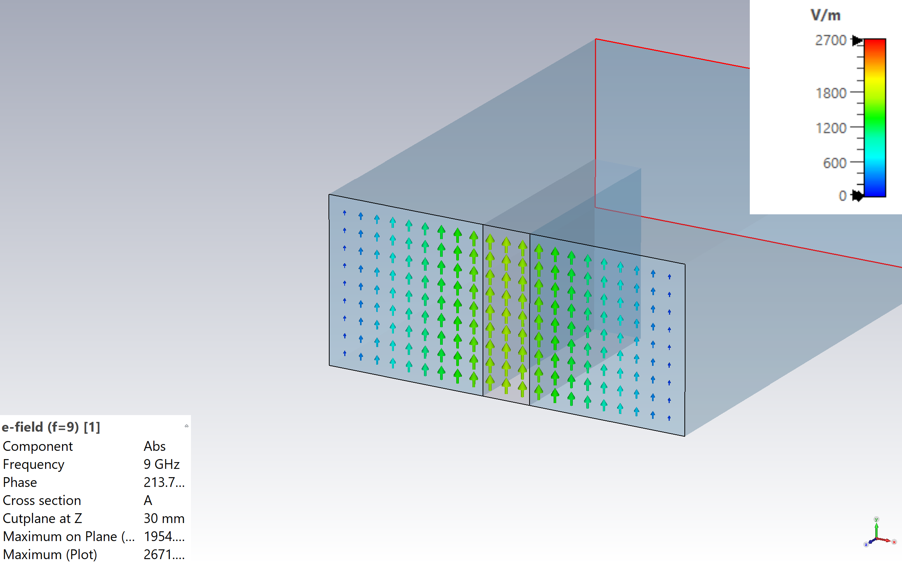
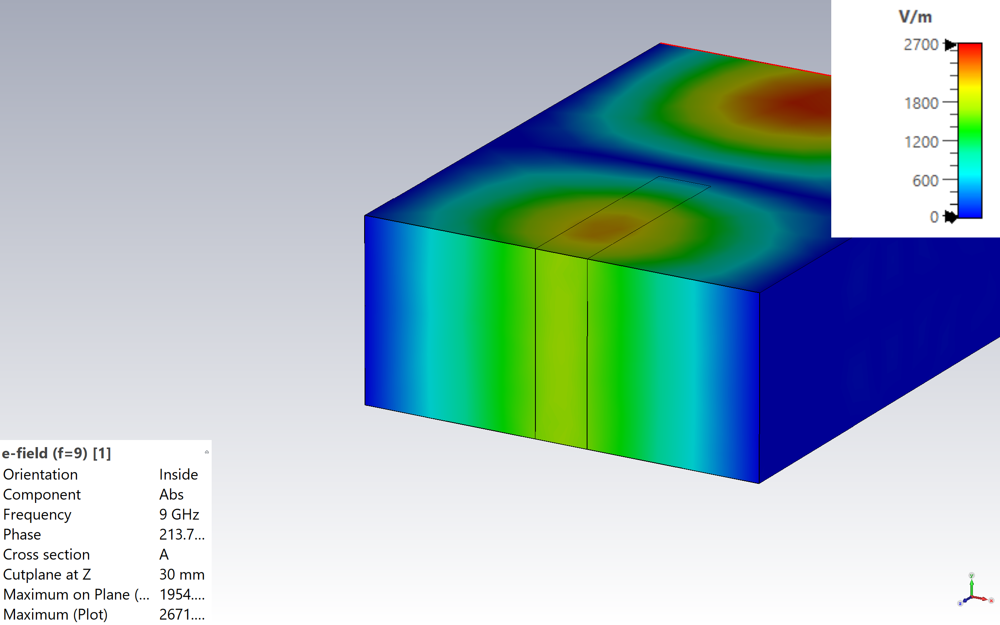
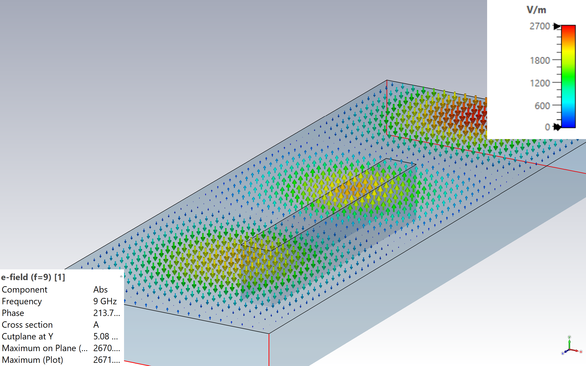
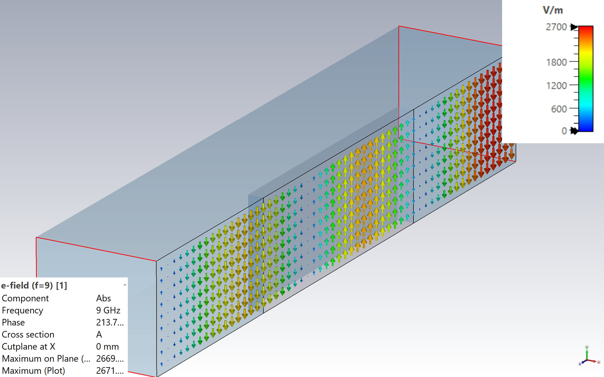

# Dielectric Slab Waveguide (9 GHz) — Analytical Modeling, CST Simulation & Automation

[](https://www.3ds.com/products-services/simulia/products/cst-studio-suite/)
[](https://www.python.org/)
[](https://ctan.org/pkg/xepersian)
[](https://opensource.org/licenses/MIT)

Design, theoretical electromagnetic analysis, automated 3D modeling, and high-frequency simulation of a **WR-90 rectangular waveguide loaded with a Teflon dielectric slab** operating at **9.0 GHz** (X-band). The slab functions as a low-reflection microwave **dielectric phase shifter** ($53.8^\circ$ differential phase shift) with over $95.6\%$ transmitted power.

Developed for the **Fields and Waves** course at **K. N. Toosi University of Technology**, Department of Electrical Engineering (Telecommunications).

---

## 📌 Project Overview

* **Base Waveguide:** Standard X-band WR-90 ($a = 22.86\text{ mm}$, $b = 10.16\text{ mm}$, length $L = 60.0\text{ mm}$, PEC walls).
* **Dielectric Slab:** Teflon (PTFE, $\varepsilon_r = 2.1$, $\tan\delta = 0.0002$) with dimensions $25.0 \times 10.16 \times 3.0\text{ mm}$ ($L_{\text{slab}} \times b \times t_{\text{slab}}$), centered transversely along the broad wall ($x=0$).
* **Operating Frequency:** $9.0\text{ GHz}$ (chosen comfortably within the single-mode band: $6.557\text{ GHz} < 9.0\text{ GHz} < 13.114\text{ GHz}$).
* **Simulation Tool:** CST Studio Suite 2026 (Tetrahedral Frequency Domain Solver).
* **Automation:** Python COM interface (`win32com`) controlling CST history list, mesh adaptation, and high-resolution export.

---

## 🔬 Analytical Formulation

### 1. Cutoff Frequencies & Single-Mode Operation
For an empty rectangular waveguide of inner dimensions $a \times b$:
$$f_{c,mn} = \frac{c}{2} \sqrt{\left(\frac{m}{a}\right)^2 + \left(\frac{n}{b}\right)^2}$$

* **Dominant mode $\text{TE}_{10}$:**
  $$f_{c,\text{TE}_{10}} = \frac{c}{2a} = \frac{2.9979 \times 10^8}{2 \times 0.02286} = \mathbf{6.557\text{ GHz}}$$
  *(Matches CST waveguide port calculation: $6.557\text{ GHz}$).*
* **Next higher mode $\text{TE}_{20}$:**
  $$f_{c,\text{TE}_{20}} = \frac{c}{a} = \mathbf{13.114\text{ GHz}}$$
* **Mode $\text{TE}_{01}$:**
  $$f_{c,\text{TE}_{01}} = \frac{c}{2b} = \mathbf{14.753\text{ GHz}}$$

The operating frequency of **9.0 GHz** provides a $37\%$ margin above $f_{c,\text{TE}_{10}}$ and a $31\%$ margin below $f_{c,\text{TE}_{20}}$, guaranteeing pure single-mode transmission free from cutoff dispersion.

### 2. Guide Wavelength & Phase Shift Derivation
In the empty guide at 9.0 GHz:
$$\lambda_0 = \frac{c}{f_0} = 33.31\text{ mm}, \quad \lambda_{g0} = \frac{\lambda_0}{\sqrt{1 - (f_c/f_0)^2}} = 48.63\text{ mm}$$
$$\beta_0 = \frac{2\pi}{\lambda_{g0}} = 129.20\text{ rad/m} = 0.1292\text{ rad/mm}$$

The simulated differential phase shift introduced by the slab ($l_{\text{slab}} = 25\text{ mm}$) is $\Delta\phi = 53.79^\circ = 0.93881\text{ rad}$. The phase constant and guide wavelength inside the dielectric-loaded section are:
$$\beta_{\text{slab}} = \beta_0 + \frac{\Delta\phi}{l_{\text{slab}}} = 129.20 + \frac{0.93881}{0.025} = \mathbf{166.75\text{ rad/m}}$$
$$\lambda_{g,\text{slab}} = \frac{2\pi}{\beta_{\text{slab}}} = \frac{2\pi}{166.75} = \mathbf{37.68\text{ mm} \approx 37.7\text{ mm}}$$

The dielectric slab compresses the guide wavelength by **$22.5\%$**, demonstrating effective dielectric loading and phase delay.

<p align="center">
  
</p>

---

## 📊 Simulation Results

### 1. S-Parameters Performance at 9.0 GHz

| Parameter | Empty Waveguide | Slab-Loaded Waveguide | Physical Interpretation |
| :--- | :---: | :---: | :--- |
| **$|S_{11}|$ (Return Loss)** | $-87.74\text{ dB}$ | **$-13.62\text{ dB}$** | $20.8\%$ Voltage Reflection ($4.3\%$ Reflected Power) |
| **$|S_{21}|$ (Insertion Loss)** | $-0.002\text{ dB}$ | **$-0.194\text{ dB}$** | $97.8\%$ Voltage Amplitude ($95.6\%$ Transmitted Power) |
| **Unwrapped $\angle S_{21}$** | $-444.13^\circ$ | **$-497.92^\circ$** | Total phase delay along $L = 60\text{ mm}$ |
| **Differential Phase ($\Delta\phi$)** | $0^\circ$ | **$53.79^\circ$** | Controlled phase shift with minimal reflection |
| **Guide Wavelength ($\lambda_g$)** | $48.63\text{ mm}$ | **$37.68\text{ mm}$** | Spatial wavelength compression in slab |

<p align="center">
  
  
</p>

### 2. Mesh Convergence Analysis
The frequency-domain tetrahedral mesh was refined by increasing sampling density and minimum step numbers:

| Mesh Quality | Tetrahedrons | Degrees of Freedom | $|S_{11}|$ (dB) | $|S_{21}|$ (dB) | Status |
| :---: | :---: | :---: | :---: | :---: | :---: |
| **Coarse** | 1,865 | 10,840 | $-13.617$ | $-0.194$ | Initial run |
| **Fine** | 3,330 | 19,432 | $-13.610$ | $-0.195$ | Refined run |
| **$\Delta$** | **$+78.5\%$** | **$+79.3\%$** | **$0.007\text{ dB}$** | **$0.001\text{ dB}$** | **Converged** |

Variation below **$0.007\text{ dB}$** confirms complete numerical stability and mesh independence.

---

## ⚡ Electromagnetic Field Distributions (9 GHz)

Field distributions were extracted across three principal cutplanes in both **Vector Arrow Representation** (showing instantaneous polarization and conductor boundary compliance) and **Smooth Shaded Continuous Contour Representation** (showing power density confinement and standing-wave antinodes):

### 1. Transverse Cross-Section ($XY$-plane at $Z = 30\text{ mm}$)
Shows the dominant vertical polarization ($E_y$), boundary condition fulfillment ($E_y \to 0$ on side conducting walls), and electric flux concentration inside the Teflon slab.

<p align="center">
  
  
</p>

<p align="center">
  
</p>

### 2. Longitudinal Horizontal Cutplane ($XZ$-plane at $Y = 5.08\text{ mm}$)
Demonstrates spatial wavelength compression along the Z-axis in the region $Z \in [17.5, 42.5]\text{ mm}$ occupied by the dielectric slab.

<p align="center">
  
  
</p>

### 3. Longitudinal Vertical Cutplane ($YZ$-plane at $X = 0\text{ mm}$)
Confirms that $E_y$ is strictly uniform along the waveguide height ($y$-axis), proving pure $\text{TE}_{10}$ propagation ($n=0$) without higher-order modal excitation.

<p align="center">
  
  
</p>

---

## 🗂️ Repository Structure

```text
├── Slab_Waveguide_9GHz.cst         # CST Studio Suite 2026 3D simulation project
├── Slab_Waveguide_9GHz.s2p         # Touchstone S-parameters (Dielectric-loaded waveguide)
├── Slab_Waveguide_Empty.s2p        # Touchstone S-parameters (Empty WR-90 waveguide)
├── Slab_Waveguide_Mesh_Coarse.s2p  # Touchstone S-parameters (Coarse mesh convergence study)
├── generate_v2_plots.py            # Python automated post-processing and plotting script
├── export_all_v2.bas               # CST VBA automation macro for high-res field exports
├── main_v2.tex                     # Complete technical report source (LaTeX / XePersian)
├── titlepage_v2.tex                # Academic title page template with TikZ borders
├── Settings.tex                    # Custom tcolorbox styling and LaTeX preamble settings
├── main_v2.pdf                     # Final compiled technical report (13 pages, 300 DPI)
├── img/                            # High-resolution (300 DPI) field and S-parameter plots
└── font/                           # Persian and Latin typography font package
```

---

## 🚀 How to Run

### 1. Python Post-Processing & Plot Generation
```bash
pip install numpy matplotlib
python generate_v2_plots.py
```

### 2. LaTeX Report Compilation
Requires TeX Live with XeLaTeX and XePersian:
```bash
xelatex -interaction=nonstopmode main_v2.tex
xelatex -interaction=nonstopmode main_v2.tex
```

---

## 📄 License

This repository is licensed under the [MIT License](LICENSE).
