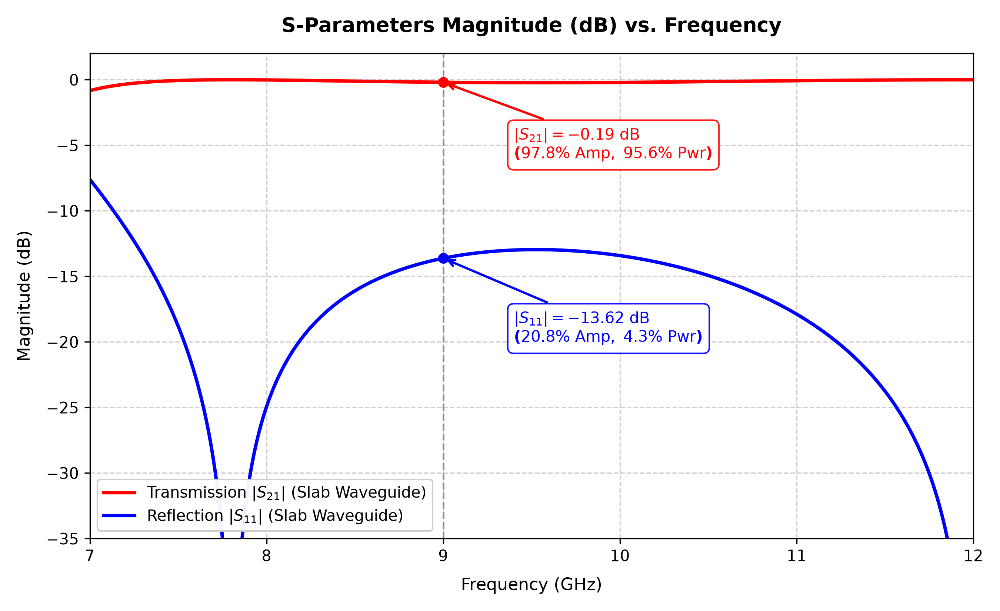
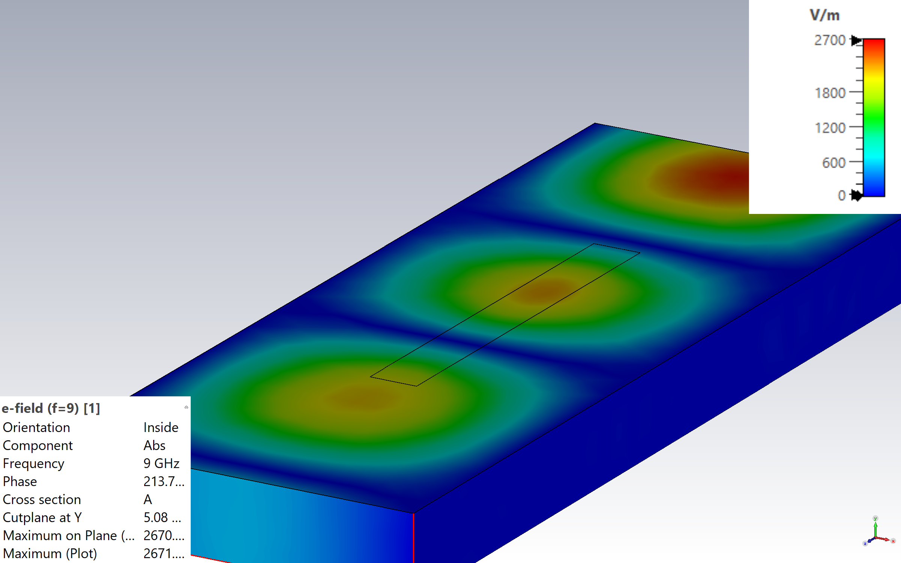

# WR-90 Dielectric Slab Waveguide (9.0 GHz Phase Shifter)

[](https://www.3ds.com/products-services/simulia/products/cst-studio-suite/)
[](https://www.python.org/)
[](https://ctan.org/pkg/xepersian)
[](https://opensource.org/licenses/MIT)

Design, theoretical electromagnetic analysis, automated 3D modeling, and high-frequency simulation of a **WR-90 rectangular waveguide loaded with a Teflon dielectric slab** operating at **9.0 GHz** (X-band). The structure acts as a compact, low-reflection microwave **phase shifter** providing a **$53.79^\circ$ differential phase delay** with over **$95.6\%$ transmitted power**.

Prepared for the **Fields and Waves** course at **K. N. Toosi University of Technology**, Faculty of Electrical Engineering.

---

## 📑 Repository Structure

```text
├── cst_model/              # CST Studio Suite 3D simulation project
│   └── Slab_Waveguide_9GHz.cst
├── data/                   # Measured Touchstone S-parameter export files (.s2p)
│   ├── Slab_Waveguide_9GHz.s2p         # Loaded waveguide with Teflon slab
│   ├── Slab_Waveguide_Empty.s2p        # Reference empty WR-90 waveguide
│   └── Slab_Waveguide_Mesh_Coarse.s2p  # Convergence mesh baseline
├── docs/                   # Compiled documentation and complete technical report
│   └── Report.pdf                      # Comprehensive 13-page academic report (PDF)
├── latex/                  # Complete LaTeX / XePersian report source
│   ├── main.tex                        # Master document source
│   ├── titlepage.tex                   # University title page with TikZ frame
│   ├── Settings.tex                    # Custom tcolorbox callout environments
│   ├── img/                            # High-resolution (300 DPI) field and S-parameter plots
│   └── font/                           # Typography font package (IRLotus, Yas, Nastaliq)
└── scripts/                # Python post-processing and CST automation macros
    ├── generate_v2_plots.py            # Matplotlib Touchstone parser & figure generator
    └── export_all_v2.bas               # CST VBA automation script for field cutplane exports
```

---

## 📌 Project Specifications

* **Waveguide Standard:** X-band WR-90 ($a = 22.86\text{ mm}$, $b = 10.16\text{ mm}$, length $L = 60.0\text{ mm}$, PEC walls).
* **Dielectric Insert:** Teflon (PTFE, $\varepsilon_r = 2.1$, $\tan\delta = 0.0002$) with dimensions $25.0 \times 10.16 \times 3.0\text{ mm}$ ($L_{\text{slab}} \times b \times t_{\text{slab}}$), centered symmetrically along the transverse broad wall ($x=0$).
* **Operating Frequency:** $9.0\text{ GHz}$ (comfortably within the single-mode band: $6.557\text{ GHz} < 9.0\text{ GHz} < 13.114\text{ GHz}$).
* **Numerical Method:** Finite Element Frequency Domain Solver with adaptive tetrahedral volume meshing in CST Studio Suite.

---

## 🔬 Theoretical Electromagnetic Analysis

### 1. Cutoff Frequencies & Single-Mode Bandwidth
For an empty rectangular metallic waveguide:
$$f_{c,mn} = \frac{c}{2} \sqrt{\left(\frac{m}{a}\right)^2 + \left(\frac{n}{b}\right)^2}$$

* **Dominant mode $\text{TE}_{10}$:**
  $$f_{c,\text{TE}_{10}} = \frac{c}{2a} = \frac{2.9979 \times 10^8}{2 \times 0.02286} = \mathbf{6.557\text{ GHz}}$$
  *(Matches CST port solver output: $6.557\text{ GHz}$).*
* **Second mode $\text{TE}_{20}$:**
  $$f_{c,\text{TE}_{20}} = \frac{c}{a} = \mathbf{13.114\text{ GHz}}$$
* **Mode $\text{TE}_{01}$:**
  $$f_{c,\text{TE}_{01}} = \frac{c}{2b} = \mathbf{14.753\text{ GHz}}$$

The operating frequency of **9.0 GHz** provides a $37\%$ margin above $f_{c,\text{TE}_{10}}$ and a $31\%$ margin below $f_{c,\text{TE}_{20}}$, ensuring strictly single-mode propagation.

### 2. Guide Wavelength & Phase Shift Derivation
In the empty section at 9.0 GHz:
$$\lambda_0 = \frac{c}{f_0} = 33.31\text{ mm}, \quad \lambda_{g0} = \frac{\lambda_0}{\sqrt{1 - (f_c/f_0)^2}} = 48.63\text{ mm}$$
$$\beta_0 = \frac{2\pi}{\lambda_{g0}} = 129.20\text{ rad/m}$$

With the Teflon slab ($l_{\text{slab}} = 25\text{ mm}$), the simulated differential phase shift is $\Delta\phi = 53.79^\circ = 0.93881\text{ rad}$. The phase constant and guide wavelength inside the slab section are:
$$\beta_{\text{slab}} = \beta_0 + \frac{\Delta\phi}{l_{\text{slab}}} = 129.20 + \frac{0.93881}{0.025} = \mathbf{166.75\text{ rad/m}}$$
$$\lambda_{g,\text{slab}} = \frac{2\pi}{\beta_{\text{slab}}} = \frac{2\pi}{166.75} = \mathbf{37.68\text{ mm} \approx 37.7\text{ mm}}$$

The dielectric slab compresses the guided wavelength by **$22.5\%$**, demonstrating localized phase velocity retardation.

<p align="center">
  
</p>

---

## 📊 S-Parameters & Performance Summary

### Numerical Results at 9.0 GHz

| Parameter | Empty Waveguide | Slab-Loaded Waveguide | Remarks |
| :--- | :---: | :---: | :--- |
| **$|S_{11}|$ (Return Loss)** | $-87.74\text{ dB}$ | **$-13.62\text{ dB}$** | $20.8\%$ Voltage Reflection ($4.3\%$ Reflected Power) |
| **$|S_{21}|$ (Insertion Loss)** | $-0.002\text{ dB}$ | **$-0.194\text{ dB}$** | $97.8\%$ Voltage Amplitude ($95.6\%$ Transmitted Power) |
| **Unwrapped $\angle S_{21}$** | $-444.13^\circ$ | **$-497.92^\circ$** | Total continuous phase delay along $L = 60\text{ mm}$ |
| **Differential Phase ($\Delta\phi$)** | $0^\circ$ | **$53.79^\circ$** | Controlled phase shift with minimal reflection |
| **Guide Wavelength ($\lambda_g$)** | $48.63\text{ mm}$ | **$37.68\text{ mm}$** | Spatial wavelength compression in slab |

<p align="center">
  
  
</p>

### Mesh Convergence Verification
To guarantee numerical stability, the tetrahedral volume mesh was refined:

| Mesh Quality | Tetrahedrons | Degrees of Freedom | $|S_{11}|$ (dB) | $|S_{21}|$ (dB) | Status |
| :---: | :---: | :---: | :---: | :---: | :---: |
| **Coarse** | 1,865 | 10,840 | $-13.617$ | $-0.194$ | Initial run |
| **Fine** | 3,330 | 19,432 | $-13.610$ | $-0.195$ | Refined run |
| **$\Delta$** | **$+78.5\%$** | **$+79.3\%$** | **$0.007\text{ dB}$** | **$0.001\text{ dB}$** | **Converged** |

---

## ⚡ Field Distributions (9.0 GHz)

Field distributions were evaluated across three principal cutplanes using both **Vector Arrows** and **Smooth Shaded Contours** with standardized dynamic color scaling ($0\text{ to }2700\text{ V/m}$ for E-field and $0\text{ to }5.2\text{ A/m}$ for H-field):

### 1. Transverse Cross-Section ($XY$-plane at $Z = 30\text{ mm}$)
Confirms dominant vertical polarization ($E_y$), conductor boundary compliance ($E_y \to 0$ on side conducting walls), and electric flux confinement in the central Teflon slab.

<p align="center">
  
  
</p>

<p align="center">
  
</p>

### 2. Longitudinal Horizontal Cutplane ($XZ$-plane at $Y = 5.08\text{ mm}$)
Shows localized spatial wavelength compression along the Z-axis in the region occupied by the dielectric slab ($Z \in [17.5, 42.5]\text{ mm}$).

<p align="center">
  
  
</p>

### 3. Longitudinal Vertical Cutplane ($YZ$-plane at $X = 0\text{ mm}$)
Confirms that $E_y$ is strictly invariant along the guide height ($y$-axis), verifying pure $\text{TE}_{10}$ mode operation ($n=0$).

<p align="center">
  
  
</p>

---

## 🛠️ Usage Instructions

### 1. Post-Processing Script
Generate all comparison plots from raw `.s2p` data:
```bash
python scripts/generate_v2_plots.py
```

### 2. LaTeX Report Compilation
Compile the Persian academic report from the `latex/` directory:
```bash
cd latex
xelatex -interaction=nonstopmode main.tex
xelatex -interaction=nonstopmode main.tex
```

---

## 📜 License

This project is licensed under the [MIT License](LICENSE).
