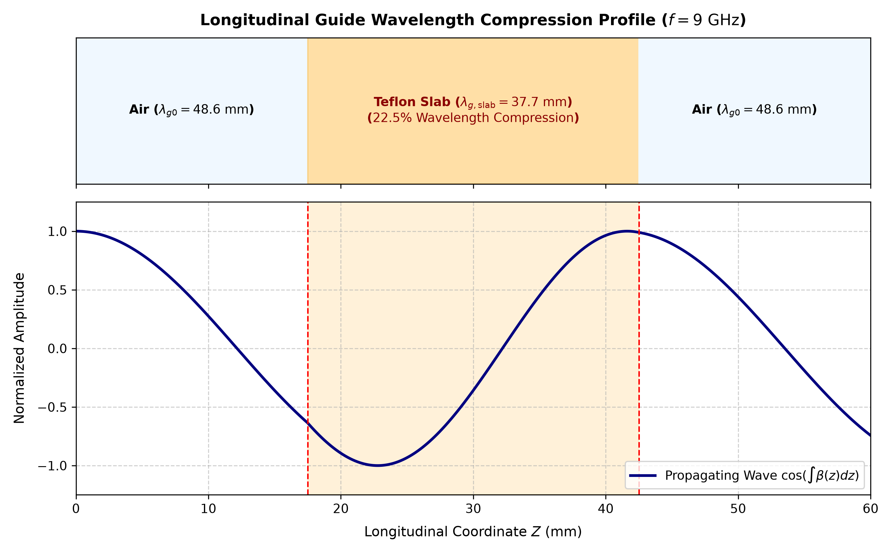
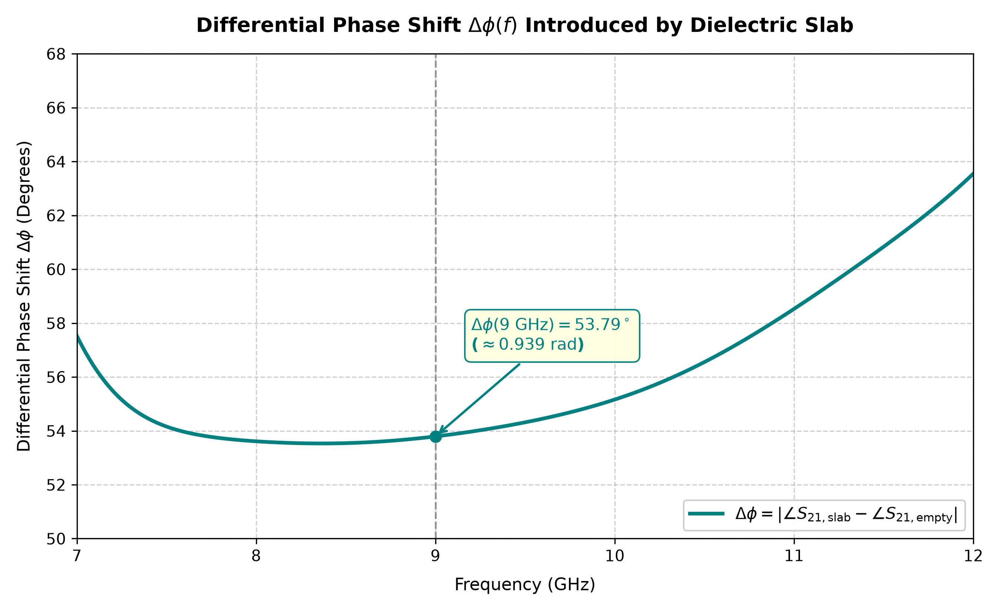
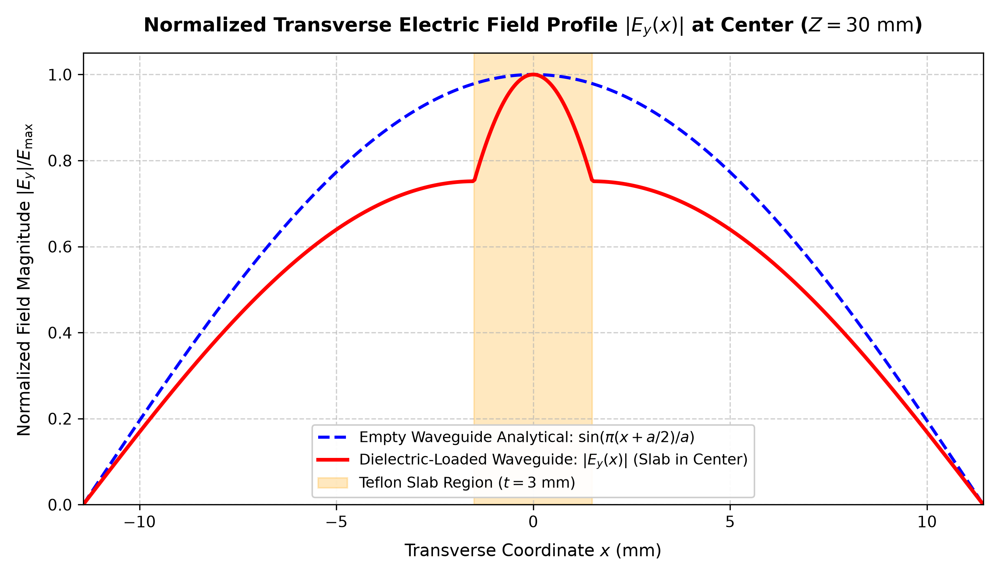
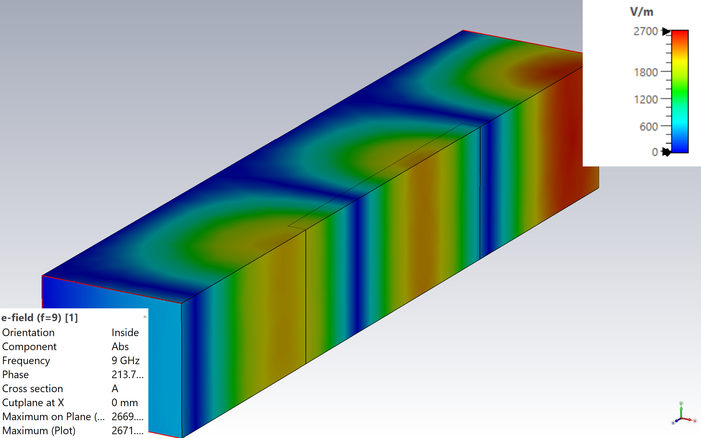

# WR-90 Dielectric Slab Waveguide (9.0 GHz Phase Shifter)

[](https://www.3ds.com/products-services/simulia/products/cst-studio-suite/)
[](https://www.python.org/)
[](https://ctan.org/pkg/xepersian)
[](https://opensource.org/licenses/MIT)

Design, theoretical electromagnetic analysis, automated 3D modeling, and high-frequency simulation of a **WR-90 rectangular waveguide loaded with a Teflon dielectric slab** operating at **9.0 GHz** (X-band). The structure acts as a compact, low-reflection microwave **phase shifter** providing a **53.79° differential phase delay** with over **95.6% transmitted power**.

Prepared for the **Fields and Waves** course at **K. N. Toosi University of Technology**, Faculty of Electrical Engineering.

---

## 📑 Repository Structure

```text
├── cst_model/              # CST Studio Suite 3D simulation project
│   └── Slab_Waveguide_9GHz.cst
├── data/                   # Measured Touchstone S-parameter export files (.s2p)
│   ├── Slab_Waveguide_9GHz.s2p         # Loaded waveguide with Teflon slab
│   ├── Slab_Waveguide_Empty.s2p        # Reference empty WR-90 waveguide
│   └── Slab_Waveguide_Mesh_Coarse.s2p  # Convergence mesh baseline
├── docs/                   # Compiled documentation and complete technical report
│   └── Report.pdf                      # Comprehensive 13-page academic report (PDF)
├── latex/                  # Complete LaTeX / XePersian report source
│   ├── main.tex                        # Master document source
│   ├── titlepage.tex                   # University title page with TikZ frame
│   ├── Settings.tex                    # Custom tcolorbox callout environments
│   ├── img/                            # High-resolution (300 DPI) field and S-parameter plots
│   └── font/                           # Typography font package (IRLotus, Yas, Nastaliq)
└── scripts/                # Python post-processing and CST automation macros
    ├── generate_v2_plots.py            # Matplotlib Touchstone parser & figure generator
    └── export_all_v2.bas               # CST VBA automation script for field cutplane exports
```

---

## 📌 Project Specifications

* **Waveguide Standard:** X-band WR-90 (a = 22.86 mm, b = 10.16 mm, length L = 60.0 mm, PEC walls)
* **Dielectric Insert:** Teflon (PTFE, εr = 2.1, tan δ = 0.0002) with dimensions 25.0 × 10.16 × 3.0 mm (L_slab × b × t_slab), centered along the broad wall (x = 0)
* **Operating Frequency:** 9.0 GHz (single-mode band: 6.557 GHz < 9.0 GHz < 13.114 GHz)
* **Numerical Method:** Finite Element Frequency Domain Solver with adaptive tetrahedral volume meshing in CST Studio Suite

---

## Theoretical Electromagnetic Analysis

### 1. Cutoff Frequencies & Single-Mode Bandwidth
For an empty rectangular metallic waveguide:

```text
fc_mn = (c / 2) * sqrt( (m / a)^2 + (n / b)^2 )
```

* **Dominant mode TE10:**
  * fc_TE10 = c / (2a) = 2.9979×10^8 / (2 × 0.02286) = **6.557 GHz**
  * *(Matches CST port solver calculation: 6.557 GHz)*
* **Second mode TE20:**
  * fc_TE20 = c / a = **13.114 GHz**
* **Mode TE01:**
  * fc_TE01 = c / (2b) = **14.753 GHz**

The operating frequency of **9.0 GHz** provides a 37% margin above fc_TE10 and a 31% margin below fc_TE20, ensuring strictly single-mode propagation.

### 2. Guide Wavelength & Phase Shift Derivation
In the empty section at 9.0 GHz:

* λ0 = c / f0 = **33.31 mm**
* λg0 = λ0 / sqrt( 1 - (fc / f0)^2 ) = **48.63 mm**
* β0 = 2π / λg0 = **129.20 rad/m**

With the Teflon slab (l_slab = 25 mm), the simulated differential phase shift is Δφ = 53.79° = 0.93881 rad:

* β_slab = β0 + (Δφ / l_slab) = 129.20 + (0.93881 / 0.025) = **166.75 rad/m**
* λg_slab = 2π / β_slab = 2π / 166.75 = **37.68 mm ≈ 37.7 mm**

The dielectric slab compresses the guided wavelength by **22.5%**, demonstrating localized phase velocity retardation.

<p align="center">
  
</p>

---

## S-Parameters & Performance Summary

### Numerical Results at 9.0 GHz

| Parameter | Empty Waveguide | Slab-Loaded Waveguide | Remarks |
| :--- | :---: | :---: | :--- |
| **|S11| (Return Loss)** | -87.74 dB | **-13.62 dB** | 20.8% Voltage Reflection (4.3% Reflected Power) |
| **|S21| (Insertion Loss)** | -0.002 dB | **-0.194 dB** | 97.8% Voltage Amplitude (95.6% Transmitted Power) |
| **Unwrapped ∠S21** | -444.13° | **-497.92°** | Total continuous phase delay along L = 60 mm |
| **Differential Phase (Δφ)** | 0° | **53.79°** | Controlled phase shift with minimal reflection |
| **Guide Wavelength (λg)** | 48.63 mm | **37.68 mm** | Spatial wavelength compression in slab |

<p align="center">
  
  
</p>

### Mesh Convergence Verification
To guarantee numerical stability, the tetrahedral volume mesh was refined:

| Mesh Quality | Tetrahedrons | Degrees of Freedom | |S11| (dB) | |S21| (dB) | Status |
| :---: | :---: | :---: | :---: | :---: | :---: |
| **Coarse** | 1,865 | 10,840 | -13.617 | -0.194 | Initial run |
| **Fine** | 3,330 | 19,432 | -13.610 | -0.195 | Refined run |
| **Difference** | **+78.5%** | **+79.3%** | **0.007 dB** | **0.001 dB** | **Converged** |

---

## Field Distributions (9.0 GHz)

Field distributions were evaluated across three principal cutplanes using both **Vector Arrows** and **Smooth Shaded Contours** with standardized dynamic color scaling (0 to 2700 V/m for E-field and 0 to 5.2 A/m for H-field):

### 1. Transverse Cross-Section (XY-plane at Z = 30 mm)
Confirms dominant vertical polarization (Ey), conductor boundary compliance (Ey → 0 on side conducting walls), and electric flux confinement in the central Teflon slab.

<p align="center">
  
  
</p>

<p align="center">
  
</p>

### 2. Longitudinal Horizontal Cutplane (XZ-plane at Y = 5.08 mm)
Shows localized spatial wavelength compression along the Z-axis in the region occupied by the dielectric slab (Z from 17.5 to 42.5 mm).

<p align="center">
  
  
</p>

### 3. Longitudinal Vertical Cutplane (YZ-plane at X = 0 mm)
Confirms that Ey is strictly invariant along the guide height (y-axis), verifying pure TE10 mode operation (n = 0).

<p align="center">
  
  
</p>

---

## 🛠️ Usage Instructions

### 1. Post-Processing Script
Generate all comparison plots from raw `.s2p` data:
```bash
python scripts/generate_v2_plots.py
```

### 2. LaTeX Report Compilation
Compile the Persian academic report from the `latex/` directory:
```bash
cd latex
xelatex -interaction=nonstopmode main.tex
xelatex -interaction=nonstopmode main.tex
```

---

## 📜 License

This project is licensed under the [MIT License](LICENSE).
